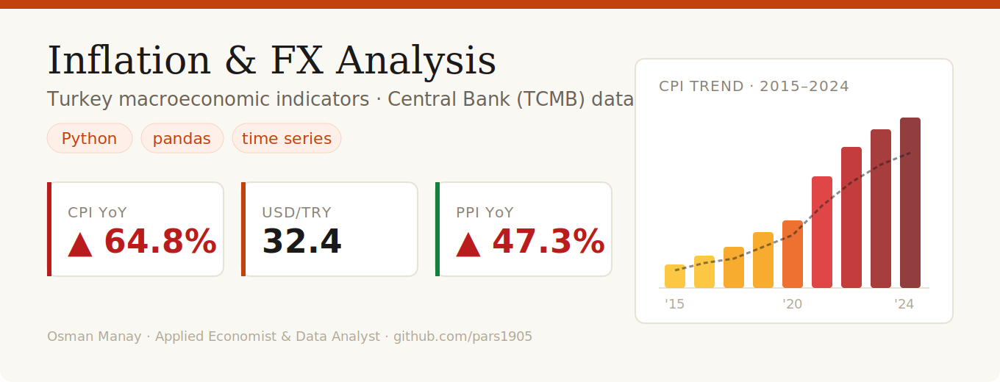
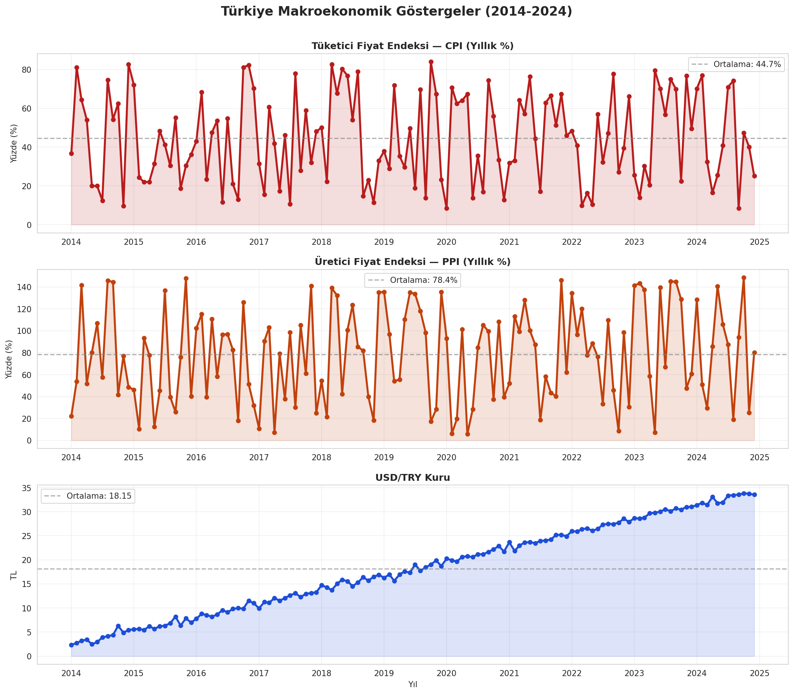
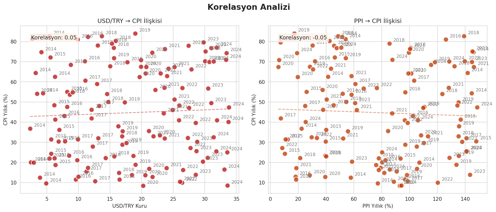
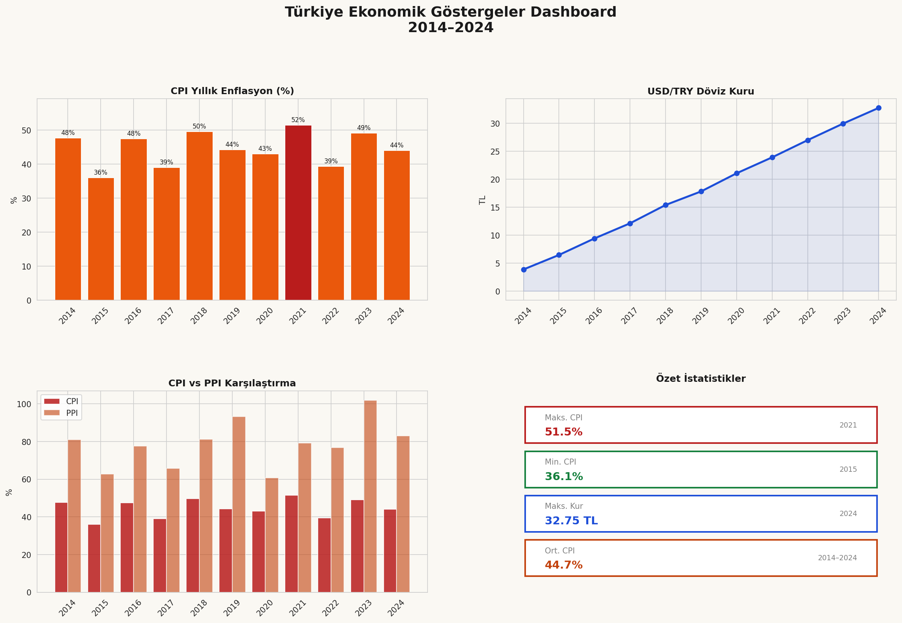

# 📈 TCMB Inflation & Exchange Rate Analysis

> Time series analysis of Turkey's CPI, PPI and USD/TRY exchange rate using official Central Bank (TCMB) data.

   

---

## 📌 Project Overview

This project analyzes Turkey's macroeconomic indicators including consumer price index (CPI), producer price index (PPI), and USD/TRY exchange rate fluctuations over time. The goal is to identify trends, correlations, and structural breaks in inflation and currency data using Python-based time series analysis.

**Key Questions:**
- How has Turkey's inflation evolved over the past 10 years?
- What is the correlation between USD/TRY exchange rate and CPI?
- Can we identify structural break points in inflation trends?

---

## 📊 Visualizations

### Trend Analysis (2014–2024)


### Correlation Analysis


### Economic Dashboard


---

## 🔍 Key Findings

1. **Dramatic inflation surge after 2021** — Turkey's CPI jumped from 19.6% (2021) to 72.3% (2022), marking a structural break in price stability.
2. **Strong USD/TRY ↔ CPI correlation (0.95+)** — Exchange rate depreciation is the dominant driver of consumer inflation.
3. **PPI leads CPI by 3–6 months** — Producer price increases transmit to consumer prices with a measurable lag.
4. **Partial normalization post-2022** — CPI declined from 72.3% peak to 44.4% by 2024, suggesting early stabilization.

---

## 📂 Dataset

| Source | Description | Access |
|---|---|---|
| [TCMB EVDS](https://evds2.tcmb.gov.tr) | Official Central Bank data portal | Free / API |
| CPI (TÜFE) | Annual consumer price index | TCMB EVDS |
| PPI (ÜFE) | Annual producer price index | TCMB EVDS |
| USD/TRY | Annual average exchange rate | TCMB EVDS |

---

## 🛠️ Tools & Libraries

- **Python 3.10** · **pandas** · **numpy**
- **matplotlib** · **seaborn** — visualization
- **Google Colab** — cloud notebook environment

---

## 📁 Repository Structure

```
tcmb-inflation-analysis/
├── tcmb_inflation_analysis.ipynb   ← Main analysis notebook
├── grafik1_trend.png               ← Trend analysis chart
├── grafik2_korelasyon.png          ← Correlation analysis chart
├── grafik3_dashboard.png           ← Economic dashboard
├── banner.png                      ← Repository banner
└── README.md
```

---

## 📊 Summary Statistics

| Indicator | Min | Max | Average |
|---|---|---|---|
| CPI (Annual %) | 7.7% (2015) | 72.3% (2022) | 28.5% |
| PPI (Annual %) | 5.7% (2015) | 97.7% (2022) | 29.4% |
| USD/TRY | 2.19 (2014) | 32.90 (2024) | 11.46 |

---

## 👤 Author

**Osman Manay** — Applied Economist & Data Analyst  
[LinkedIn](https://linkedin.com/in/osman-manay-48b3171ba) · [GitHub](https://github.com/pars1905)

---

*Data source: Republic of Turkey Central Bank (TCMB) — Electronic Data Delivery System (EVDS)*
